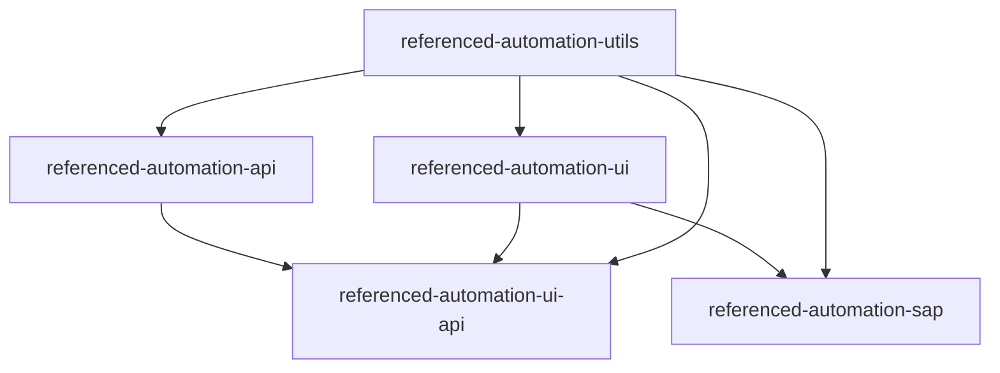

# Cross-Repo Code Sharing Guide

This is the one document that explains how the five `referenced-automation-*`
repos fit together, end to end: how code is shared between them, how to build
and consume packages, how environment configuration works, how to use and
override fixtures/methods, and everything else a new joiner needs to get
productive. Each repo's own `README.md` documents *that repo's* features in
depth - this guide is the map that ties all five together.

If you only read one section, read [Build, package, consume: the day-to-day loop](#5-day-to-day-change-a-shared-package-upgrade-a-consumer)
and [New joiner checklist](#16-new-joiner-checklist).

## Table of contents

1. [The repo family at a glance](#1-the-repo-family-at-a-glance)
2. [One-time machine setup](#2-one-time-machine-setup)
3. [Cloning and bootstrapping the repos](#3-cloning-and-bootstrapping-the-repos)
4. [How cross-repo code sharing works](#4-how-cross-repo-code-sharing-works)
5. [Day to day: change a shared package, upgrade a consumer](#5-day-to-day-change-a-shared-package-upgrade-a-consumer)
6. [Environment configuration](#6-environment-configuration)
7. [What you can import from each package](#7-what-you-can-import-from-each-package)
8. [Using fixtures in your tests](#8-using-fixtures-in-your-tests)
9. [Writing page objects and components](#9-writing-page-objects-and-components)
10. [Overriding / customizing behavior](#10-overriding--customizing-behavior)
11. [Mocking APIs - which tool, when](#11-mocking-apis---which-tool-when)
12. [Testing conventions](#12-testing-conventions)
13. [CI/CD](#13-cicd)
14. [IDE setup](#14-ide-setup)
15. [Troubleshooting / known gotchas](#15-troubleshooting--known-gotchas)
16. [New joiner checklist](#16-new-joiner-checklist)

---

## 1. The repo family at a glance

| Repo | What it is | Depends on |
|---|---|---|
| `referenced-automation-utils` | Shared, framework-agnostic TS utilities (env config, logging, crypto, date, random data, JSON/YAML/CSV/Excel, JSON Schema validation, object-path traversal, DB access, SMTP, SFTP). No Playwright, no browser. | *nothing* |
| `referenced-automation-api` | Playwright-based API testing framework (`ApiClient`, auth strategies, pagination, response traversal) + API mocking tools (`MockServer`, `mockApiRoute`, record/replay). | `utils` |
| `referenced-automation-ui` | Playwright UI testing framework (`actions`, fixtures, accessibility, device emulation). | `utils` |
| `referenced-automation-sap` | SAP automation on Playwright: Fiori/UI5 helpers (`byControlId`, `waitForUI5Ready`) **and** classic SAP GUI - converts SAP GUI Scripting recordings (`.vbs`) into Playwright tests that wait for SAP by themselves. | `ui`, `utils` |
| `referenced-automation-ui-api` | Demo/glue repo proving `ui` + `api` compose (shared login session, mocking a UI page's runtime API data). Not a publishable package. | `api`, `ui`, `utils` |

Dependency graph:



This mirrors a Maven/Nexus multi-module setup, just with npm instead of Maven:
`utils` is the equivalent of a shared `commons` artifact every other module
depends on; `api`/`ui` are mid-level modules; `sap`/`ui-api` are leaf
consumers.

## 2. One-time machine setup

- **Node.js** ≥ 18, **npm** ≥ current LTS (any repo's `package.json` sets
  `"engines": { "node": ">=18" }`). You may see an `EBADENGINE` warning about
  `eslint-visitor-keys` wanting a newer Node - this is cosmetic and safe to
  ignore.
- **Sibling checkout layout (for local mode and for working across repos).**
  When you use `setup.sh --local` or change shared code, the repos, plus a
  `shared-packages` folder that gets created automatically, live next to
  each other under the same parent directory:

  ```
  Projects/
  ├── referenced-automation-utils/
  ├── referenced-automation-api/
  ├── referenced-automation-ui/
  ├── referenced-automation-sap/
  ├── referenced-automation-ui-api/
  └── shared-packages/          <- created by the build scripts, not checked out
  ```

  The `--local` scripts assume this layout (`../shared-packages`,
  `../referenced-automation-<name>`). Cloning the repos anywhere else, or
  nested inside each other, breaks them.
- **Registry.** The `@automation/*` packages are installed **by version** from
  your organisation's npm registry (Artifactory). Set its address once in the
  `NPM_REGISTRY_URL` variable (your shell profile, or a CI/CD variable): every
  `scripts/setup.sh`/`setup.bat` then runs
  `npm config set registry "$NPM_REGISTRY_URL"` before any other npm command.
  The URL is org-specific and is never hard-coded in these repos; ask your team
  lead for it. If Playwright's own browser binaries aren't downloadable in a
  restricted environment, use a system-installed browser instead of Playwright's
  bundled ones (see `referenced-automation-ui`'s README,
  `BROWSER=msedge`/`BROWSER=chrome`, and `PLAYWRIGHT_SKIP_BROWSER_DOWNLOAD=1`).

## 3. Cloning and bootstrapping the repos

Clone the repo(s) you work in (all five if you want to change shared code):

```bash
mkdir Projects && cd Projects
git clone <url>/referenced-automation-utils.git
git clone <url>/referenced-automation-api.git
git clone <url>/referenced-automation-ui.git
git clone <url>/referenced-automation-sap.git
git clone <url>/referenced-automation-ui-api.git
```

Then, in each repo you use:

```bash
export NPM_REGISTRY_URL="<your registry URL>"     # Windows cmd: set NPM_REGISTRY_URL=<your registry URL>
./scripts/setup.sh                                 # Windows: scripts\setup.bat
```

What each `setup.sh` does - the first step is always the registry:

| Repo | Steps |
|---|---|
| `utils` | `npm config set registry "$NPM_REGISTRY_URL"`, `npm ci`. No browser install (pure Node). |
| `api` | Registry, then `npm ci` (`@automation/referenced-automation-utils` comes from the registry, at the version in `package.json`). No browser install. |
| `ui` | Registry, `npm ci` (utils, api from the registry), then `npx playwright install --with-deps` (all 3 browsers) unless `PLAYWRIGHT_SKIP_BROWSER_DOWNLOAD=1`. |
| `sap` | Registry, `npm ci` (utils, ui from the registry), then `playwright install --with-deps chromium` only. |
| `ui-api` | Registry, `npm ci` (utils, api, ui, sap from the registry), then the full browser install. |

If `NPM_REGISTRY_URL` is not set, the script says so and npm keeps the registry
it is already configured with. If `npm ci` stops on an `@automation/*` package,
that version is not in the registry yet: publish it (section 4) or use
`./scripts/setup.sh --local` (section 4), which builds the packages from
sibling checkouts instead and fails with a clear message naming the repo to
clone if one is missing.

(On Windows, use `scripts\setup.bat` instead of `./scripts/setup.sh`.)

## 4. How cross-repo code sharing works

The four shared repos (`utils`, `api`, `ui`, `sap`) are npm packages named
`@automation/referenced-automation-<name>`. A consuming repo lists them in
`package.json` like any other dependency, **by version**:

```jsonc
"dependencies": {
  "@automation/referenced-automation-utils": "^1.0.0"
}
```

`npm ci`/`npm install` downloads that version from the registry set by
`npm config set registry "$NPM_REGISTRY_URL"` (which every `setup` script runs
first). Nothing is built, copied or placed by hand, and upgrading is a
one-line change (section 5). Everything below follows from that.

### 4.1 Publishing a package to the registry (JFrog Artifactory)

A version has to be published before anyone can ask for it. In the repo that
owns the package (`utils`, `api`, `ui` or `sap`):

1. **Registry URL:** the npm registry URL of your Artifactory, the same one as
   the `NPM_REGISTRY_URL` CI/CD variable. Not hard-coded anywhere; ask your
   platform team.
2. **Permission:** you need an npm identity that may deploy to that repository.
   How npm authenticates against your Artifactory is your organisation's own
   procedure and is not described here; the scripts never log in for you.
3. **Version:** every version can be published once. Bump it and note it in
   the changelog, then commit:
   ```bash
   npm version patch --no-git-tag-version      # or minor / major
   ```
4. **Publish** (a dry run first):
   ```bash
   export NPM_REGISTRY_URL="<your registry URL>"
   ./scripts/publish-package.sh --dry-run       # Windows: scripts\publish-package.bat --dry-run
   ./scripts/publish-package.sh
   ```
   `publish-package` sets the registry, builds with `create-package.sh`
   (`npm ci`, `npm run clean`, `npm run build`, `npm pack`) and runs
   `npm publish <tarball> --registry "$NPM_REGISTRY_URL"`. It stops with a
   message if `NPM_REGISTRY_URL` is not set.
5. **Verify:** `npm view @automation/referenced-automation-<name> versions --registry "$NPM_REGISTRY_URL"`.

**Without the script:** `./scripts/create-package.sh` writes
`../shared-packages/automation-referenced-automation-<name>-<version>.tgz` -
exactly what `npm publish` uploads. Publish that file with `npm publish <file>
--registry "$NPM_REGISTRY_URL"`, or deploy the file through the Artifactory web
UI (the repository's **Deploy** action reads the name and version from the
tarball), or give it to whoever manages the repository.

**Order:** publish `utils` first, then `api` and `ui`, then `sap`, then use the
new versions in the repos that consume them. `ui-api` is `"private": true`, has
no `create-package.sh` and is never published.

(Filename note: because the package is scoped, `npm pack` names the file
`automation-referenced-automation-<name>-<version>.tgz`.)

### 4.2 Using a package without a registry (local generation)

When the registry does not have the version yet, or you want to try a change
before publishing it. `package.json` and the lockfile are not touched.

**Automatic** - repos checked out as siblings under one parent directory:

```bash
./scripts/setup.sh --local        # Windows: scripts\setup.bat --local   (or USE_LOCAL_PACKAGES=1)
```

It runs `create-package.sh --local` in each sibling this repo depends on
(`--local` builds that sibling's own dependencies in turn, without needing the
registry), keeps the `.tgz` files in `../shared-packages` (created if missing),
and runs `npm install --no-save` on them.

**Manual** - generate the tarball, place it yourself:

```bash
(cd ../referenced-automation-utils && ./scripts/create-package.sh --local)    # one per needed package
# optional: copy the .tgz into the consuming repo, e.g. into libs/ (keep it out of git)
npm install --no-save ../shared-packages/automation-referenced-automation-utils-<version>.tgz
```

List **all** the `@automation/*` tarballs the repo needs in the one command.
`--no-save` keeps `package.json` and the lockfile unchanged; run the command
again after every `npm ci` (which removes what the lockfile does not list) and
after rebuilding a tarball with the same version. `npm ci` takes you back to
the registry versions.

`ui-api` has no `create-package.sh` of its own - nothing depends on it.

### 4.3 First rollout: publish everything, then install from the registry

A walkthrough to prove the whole chain works from the registry, with no local tarballs. Run each step in the repo named.

1. **Set the registry** (every terminal; the URL is your Artifactory npm registry, the `NPM_REGISTRY_URL` CI/CD variable):
   ```bash
   export NPM_REGISTRY_URL="<your registry URL>"
   ```
   Authenticate npm against it with your organisation's own procedure (not covered here; the scripts never log in).
2. **Publish in dependency order.** The first publish of each package uses its current version (1.0.0) as it is - bump the version only for later releases. In `referenced-automation-utils`:
   ```bash
   ./scripts/publish-package.sh --dry-run     # check what would be uploaded
   ./scripts/publish-package.sh
   ```
   Then the same two commands in `referenced-automation-api` and `referenced-automation-ui`, then `referenced-automation-sap`. The order matters because each publish builds the package with `npm ci`, which needs the packages it depends on to be in the registry already.
3. **Confirm they arrived:**
   ```bash
   for p in utils api ui sap; do npm view @automation/referenced-automation-$p versions --registry "$NPM_REGISTRY_URL"; done
   ```
4. **Install a consumer from the registry - no `--local`.** In `referenced-automation-ui-api` (it uses all four packages):
   ```bash
   rm -rf node_modules
   ./scripts/setup.sh                          # Windows: scripts\setup.bat
   ```
   The output starts with the registry line and then `== Installing dependencies from the registry ==`; `npm ci` downloads `@automation/referenced-automation-utils`, `-api`, `-ui` and `-sap` by the versions in `package.json`.
5. **Check where they came from:**
   ```bash
   npm config get registry                                  # your registry URL
   npm ls @automation/referenced-automation-utils           # the published version
   grep -A2 '"node_modules/@automation/referenced-automation-utils"' package-lock.json    # resolved: a URL under your registry
   ```
   The committed lockfiles do not yet hold a `resolved` address for these packages; once npm has installed them from the registry the lockfile gains it (run `npm install` once if it did not). Commit `package-lock.json` in each consumer.
6. `npm test` in the consumer to finish.

If step 4 stops with "No matching version found for @automation/...", that version is not in the registry `npm config get registry` shows: check step 3 and the URL.

## 5. Day to day: change a shared package, upgrade a consumer

You change something in a shared repo (say `utils`) and want its consumers to
use it. With a registry this is publish + one version line:

**Step 1 - change and verify in the repo you edited:**

```bash
cd referenced-automation-utils
# edit src/...
npm run build && npm run lint && npm test
```

**Step 2 - release a new version:** bump `version` (`npm version minor
--no-git-tag-version`), add the changelog entry, commit, then publish it
(section 4.1). `create-package.sh` runs `npm run clean` before `npm run build`
because `tsc`'s incremental compiler does not delete output for source files you
deleted or renamed - never package from a bare `npm run build`.

**Step 3 - upgrade each direct consumer by changing one version.** In
`referenced-automation-api`'s `package.json`:

```jsonc
"@automation/referenced-automation-utils": "^1.1.0"     // was ^1.0.0
```

```bash
npm install            # downloads 1.1.0 from the registry in NPM_REGISTRY_URL and updates package-lock.json
npm run build && npm run lint && npm test
git add package.json package-lock.json
```

- `^1.1.0` accepts any `1.x` from 1.1.0 up; write `1.1.0` to pin exactly.
- `npm ci` (CI, `setup.sh`) installs exactly what the lockfile records, so a
  version only changes when someone commits the change. **Do not delete
  `package-lock.json`** - without it every dependency, Playwright included,
  floats to whatever is newest.
- The committed lockfiles record each `@automation/*` version but not its
  download address; the first `npm install` against the real registry adds the
  address and checksum (`resolved`, `integrity`) - commit that.
- If the consumer is itself shared (`ui`, which `sap` and `ui-api` use),
  publish it, then repeat for the next level down:
  `utils` -> `api`/`ui` -> `sap` -> `ui-api`.

**Trying a change before publishing:** use local generation (section 4.2) and
test against it; publish when you are happy. In local mode, rebuild with
`create-package.sh --local` and re-run `npm install --no-save <tgz>` after each
change (same version, new contents).

In short: **edit -> build/test in place -> bump version -> publish -> change
the version in each consumer's `package.json` -> `npm install` -> build/test ->
repeat downstream.**

## 6. Environment configuration

Every repo follows the identical pattern, built on `utils`'s `loadEnv()`.

### The `ConfigReader` / `loadEnv()` API (from `utils`)

```ts
import { loadEnv } from '@automation/referenced-automation-utils';

const env = loadEnv();                     // ENV var, defaulting to "qa"
const env2 = loadEnv({ env: 'stage' });     // force a specific env for this call
const env3 = loadEnv({ dir: __dirname });   // load .env.<name> files from a specific directory
```

`ConfigReader` methods:

| Method | Behavior |
|---|---|
| `get(key, defaultValue?)` | Returns the string value, or `defaultValue`. Throws if missing and no default given. |
| `getOptional(key, defaultValue?)` | Same, but returns `undefined` instead of throwing when absent. |
| `getInt(key, defaultValue?)` | Parses as an integer. Throws on a non-numeric value, or if missing with no default. |
| `getBoolean(key, defaultValue = false)` | `'true'` (case-insensitive, trimmed) → `true`; anything else → the default. |
| `getList(key, defaultValue = [])` | Comma-separated string → trimmed array, e.g. `FEATURE_FLAGS=a,b,c` → `['a','b','c']`. |
| `has(key)` | `true`/`false`. |
| `envName` (getter) | The resolved environment name (`get('ENV', 'qa')`). |
| `toObject()` | Snapshot of every known key as a plain object. |

**Environment name resolution order:** explicit `options.env` →
`process.env.ENV` → `process.env.ENVIRONMENT` → `'qa'` (default).

**Value load order (later wins):** `.env` → `.env.<name>` →
`.env.<name>.local` → real `process.env` (CI secrets, or
`FOO=bar npx playwright test` on the command line, always win over any file).

### What to actually set up locally

Every repo ships:
- **`.env.example`** - a committed template, safe to read, no secrets. Copy
  patterns from it, don't rely on it being loaded at runtime (it isn't -
  `loadEnv()` never reads a file literally named `.env.example`).
- **`.env.dev` / `.env.qa` / `.env.stage`** - real, committed, non-secret
  per-environment values (URLs, log level, feature toggles). These *are*
  loaded automatically by `ENV=<name>`.
- **`.env.<name>.local`** (you create this, gitignored) - real credentials/
  secrets for whichever environment you're pointed at locally. Never commit
  this file.

Run against a specific environment with:

```bash
ENV=qa npx playwright test
ENV=stage npx playwright test
```

### Env vars per repo

**`utils`** (`LOG_LEVEL`, `TZ`) - has no URLs/credentials of its own; its
`.env.example` exists purely to document the pattern other repos build on.

**`api`**

| Var | Purpose |
|---|---|
| `LOG_LEVEL` | winston log level |
| `API_BASE_URL` | base URL `ApiClient`/the `apiClient` fixture point at |
| `API_KEY` | example - replace with whatever real auth your target API needs |

**`ui`**

| Var | Purpose |
|---|---|
| `LOG_LEVEL` | winston log level |
| `BASE_URL` | `use.baseURL` in `playwright.config.ts` |
| `HEADLESS` | headed vs headless |
| `BROWSER` | `chromium`\|`firefox`\|`webkit`\|a system channel (`msedge`,`chrome`)\|`all`\|`all-devices` |
| `DEVICE`, `WORKERS`, `RETRIES`, `MAX_FAILURES`, `TEST_TIMEOUT_MS`, `EXPECT_TIMEOUT_MS`, `ACTION_TIMEOUT_MS`, `NAVIGATION_TIMEOUT_MS`, `GLOBAL_TIMEOUT_MS`, `SLOW_MO_MS`, `LOCALE`, `TIMEZONE_ID`, `COLOR_SCHEME`, `IGNORE_HTTPS_ERRORS`, `VIEWPORT_WIDTH`/`VIEWPORT_HEIGHT`, `TEST_ID_ATTRIBUTE` | See `ui`'s own README for the full enterprise-config table - all optional, all env-driven. |

**`sap`**: `LOG_LEVEL`, `HEADLESS`, `BASE_URL` (points at your Fiori launchpad).

**`ui-api`**: `LOG_LEVEL`, `HEADLESS`, `BASE_URL`, `API_BASE_URL` (its own
tests spin up an in-process server and don't actually read these - they're
the template a real hybrid UI+API project follows).

### Where NOT to put connection details

`utils` ships `DbClient`, `SmtpConfig`/`SmtpClient`, `SftpConfig`/`SftpClient`
etc. as **generic, parameterized** clients - it never contains a real host,
username, password, or connection string. Those always belong in whichever
repo actually calls the client, read via that repo's own `loadEnv()`:

```ts
// inside api/ui/sap/ui-api - never inside utils
import { loadEnv, SftpClient } from '@automation/referenced-automation-utils';

const env = loadEnv();
const sftp = new SftpClient();
await sftp.connect({
  host: env.get('SFTP_HOST'),
  username: env.get('SFTP_USER'),
  password: env.get('SFTP_PASSWORD'), // from .env.<name>.local or a CI secret
});
```

This keeps `utils` genuinely generic and safe to depend on from every repo,
and keeps every real secret exactly where it's used and rotated. See
`utils`'s own README ("Where connection details actually live") for more.

## 7. What you can import from each package

### `@automation/referenced-automation-utils`

```ts
import {
  loadEnv, ConfigReader,                    // env config
  logger, loggedStep,                       // logging
  crypto, dateUtils, randomUtils,           // namespaced helpers
  jsonUtils, yamlUtils, csvUtils, excelUtils,
  getPath, setPath, hasPath, requirePath,   // object-path traversal
  validateSchema,                           // JSON Schema (ajv)
  CommonsError,
  DbClient, SqliteClient,                   // DB
  emailUtils, SmtpClient,                   // one-shot vs pooled SMTP
  SftpClient,                               // WinSCP-equivalent SFTP client
  placeholders,                             // ScenarioVariables: {{uuid}}, {{random:email}}, {{date:+7d}}, {{env:X}}
} from '@automation/referenced-automation-utils';
```

| Namespace | Functions |
|---|---|
| `crypto` | `md5Hex`, `sha1Hex`, `sha256Hex`, `sha512Hex`, `hmacSha256Hex`, `hmacSha1Hex`, `base64Encode`, `base64Decode`, `mask` |
| `dateUtils` | `today`, `now`, `formatDate`, `formatDateTime`, `parseDate`, `parseDateTime`, `addDays`, `addMonths`, `addHours`, `addMinutes`, `daysBetween`, `isBefore`, `isAfter`, `toEpochMillis`, `fromEpochMillis`, `timestampForFileName` |
| `randomUtils` | `firstName`, `lastName`, `fullName`, `email`, `phoneNumber`, `streetAddress`, `city`, `country`, `companyName`, `jobTitle`, `uuid`, `number(min,max)`, `alphaNumeric(len)`, `numericString(len)`, `futureDate(maxDays)`, `pastDate(maxDays)`, `creditCardNumber`, and the raw `faker` instance |
| `jsonUtils` | `toJson`, `toPrettyJson`, `fromJson`, `fromJsonFile`, `readAt(json, path)` |
| `yamlUtils` | `toYaml`, `fromYaml`, `fromYamlFile` |
| `csvUtils` | `parseCsv`, `parseCsvFile`, `toCsv`, `writeCsvFile` |
| `excelUtils` | `readSheet`, `writeSheet` |
| `emailUtils` | `sendEmail(config, message)`, `findEmailBySubject(config, subjectContains, options?)` |

Plus the classes: `SqliteClient implements DbClient` (`query`, `queryScalar`,
`update`, `close`), `SmtpClient` (`verify`, `send`, `close`), `SftpClient`
(`connect`, `upload`, `download`, `list`, `exists`, `delete`, `mkdir`,
`rmdir`, `close`).

### `@automation/referenced-automation-api`

```ts
import {
  ApiClient, ApiResponse,
  xml,                                              // namespaced XML (de)serialization
  BasicAuth, BearerAuth, ApiKeyAuth, OAuth2ClientCredentials,
  paginateByPageNumber, paginateByCursor,
  MockServer, mockApiRoute, mockApiRoutes, unmockApiRoute,
  recordApiTraffic, playApiRecording,
  OAuth2PasswordAuth, JwtAuth, HmacAuth, SessionCookieAuth, CompositeAuth,
  pollUntil, mapConcurrent, CleanupRegistry, toCurl, maskFields,
  registerApiSteps, registerDataSteps,              // Gherkin steps (playwright-bdd)
  test, expect,                                     // apiClient / apiFor / cleanup / vars fixtures; expect has ApiResponse matchers
} from '@automation/referenced-automation-api';
```

The API package also ships `api-curl-to-playwright` (curl commands -> tests; `npx api-curl-to-playwright curl/ --out tests/generated`).
Every converter (`api-curl-to-playwright`, `ui-codegen-to-playwright`, `sap-vbs-to-playwright`) writes tests that start with the same two kinds of object, which the steps only refer to: `CONSTANTS` (everything typed, sent or expected; secrets as getters that read the environment) and the locators (`LOCATORS` for UI and SAP, `ENDPOINTS` for API). Change an input or fix a locator once, at the top; `--inline` opts out.
Retries, polling, idempotency keys, downloads, GraphQL/SOAP and the exchange log are on `ApiClient`; see its `docs/PLAYWRIGHT_COVERAGE.md`.

### `@automation/referenced-automation-ui`

```ts
import { step, test, guardedTest, expect, actions, locators, assertions,
  dialogs, network, storage, emulation, clock, tabs, evaluate, visual, performance, guardPage,
  checkAccessibility, expectNoAccessibilityViolations, formatViolations,
  registerUiSteps, registerDataSteps,                // Gherkin steps (playwright-bdd)
} from '@automation/referenced-automation-ui';
```

The UI package also ships `ui-codegen-to-playwright` (a `playwright codegen` recording -> a test in this style; `--page-objects`,
`--data`). Beyond `actions` it covers dialogs, network mocking/HAR/WebSocket, storage and a second signed-in user, emulation,
clock, tabs, evaluate, ARIA/visual snapshots, performance budgets and a page guard; `docs/PLAYWRIGHT_COVERAGE.md` maps each
to Playwright's documentation.

`actions` is a namespace of ~35 standalone functions covering everything a
page object needs - navigation, element interaction, reads, waits,
screenshots, frames, new tabs, downloads/uploads, and basic route
mocking/blocking. Full list: `click`, `dblClick`, `rightClick`, `fill`,
`type`, `clear`, `check`, `uncheck`, `selectOption`, `hover`, `dragAndDrop`,
`pressKey`, `focus`, `uploadFile`, `getText`, `getValue`, `getAttribute`,
`isVisible`, `isEnabled`, `isChecked`, `count`, `allText`, `waitForVisible`,
`waitForHidden`, `screenshotElement`, `goto`, `reload`, `goBack`,
`goForward`, `currentUrl`, `title`, `waitForUrlContains`, `waitForLoadState`,
`waitForResponseMatching`, `screenshotPage`, `frame`, `waitForNewTab`,
`downloadFile`, `mockRoute`, `blockRoute`, `unrouteAll`.

> **Note on the two mocking tools:** `actions.mockRoute`/`blockRoute` here
> are simple built-ins (fulfil/abort a URL pattern with a fixed response).
> `referenced-automation-api`'s `mockApiRoute` is the richer, dedicated tool
> (method filtering, dynamic bodies computed per-request, proper fallthrough)
> and is the one to reach for in a real UI test that needs to mock runtime
> API data - see [section 11](#11-mocking-apis---which-tool-when).

### `@automation/referenced-automation-sap`

```ts
import { byControlId, waitForUI5Ready, actions, step, test, expect } from '@automation/referenced-automation-sap';
```

For Fiori/UI5, `sap` adds `byControlId`/`waitForUI5Ready`; everything else
(`actions`, `step`, `test`, `expect`) is re-exported straight from `ui`, so a
SAP test only ever needs one import line.

For classic SAP GUI it adds:

```ts
import { sapGuiTest, SapGuiSession, convertVbs, parseVbs, createSampleSapSystem } from '@automation/referenced-automation-sap';
```

and two commands: `sap-vbs-to-playwright <recording.vbs|folder>` (recording -> spec) and
`sap-gui-doctor` (checks a Windows machine can drive SAP GUI). Tests that drive real SAP
run only on Windows with SAP GUI installed and are *skipped* elsewhere. See
`referenced-automation-sap`'s README, which also says what is and is not verified.

### `referenced-automation-ui-api`

Not a publishable package (`"private": true`, no `main`/`exports`) - it's a
demo repo, not something you `import` into a fourth project. Read its tests
as worked examples instead.

## 8. Using fixtures in your tests

A Playwright fixture is a named value your test can ask for by destructuring
it out of the test's argument object - Playwright builds it lazily, only for
tests that actually request it, and tears it down after. `base.extend({...})`
is how you add a new fixture on top of Playwright's built-ins (`page`,
`context`, `browser`, ...) or on top of fixtures another `test.extend` in the
chain already added.

### `api`'s built-in fixtures

```ts
import { test, expect } from '@automation/referenced-automation-api';

test('gets a user', async ({ apiClient }) => {
  const response = await apiClient.get('/users/{id}', { pathParams: { id: 42 } });
  expect(response.status()).toBe(200);
});

test('mocks a backend for this test only', async ({ mockServer, apiClient }) => {
  mockServer.get('/users/42', { id: 42, name: 'Ada' });
  // point a fresh ApiClient at mockServer.baseUrl, or use it directly with fetch/whatever client you need
});
```

`apiClient` is pre-pointed at `API_BASE_URL` from the active `.env.<name>`.
`mockServer` is a fresh `MockServer`, started before the test and stopped
after - you only pay the startup cost in tests that ask for it.

### `ui`'s page-object fixture pattern

`ui`'s own `test`/`expect` (from `src/fixtures/uiFixtures.ts`) doesn't ship
any page-object fixtures itself - it only adds `beforeEach`/`afterEach`
scenario logging. **Every consuming project is expected to layer its own
page-object fixtures on top**, exactly like `ui`'s own
`tests/support/fixtures.ts` does:

```ts
import * as path from 'node:path';
import { test as base, expect } from '@automation/referenced-automation-ui'; // or '../../src/fixtures/uiFixtures' inside this repo itself
import { createLoginPage, type LoginPage } from './LoginPage';
import type { DashboardPage } from './DashboardPage';

interface PageFixtures {
  loginPage: LoginPage;
  dashboardPage: DashboardPage; // already authenticated, for specs that don't care about the login step
}

export const test = base.extend<PageFixtures>({
  loginPage: async ({ page }, use) => {
    const loginPage = createLoginPage(page);
    await loginPage.open('/login');
    await use(loginPage);
  },
  dashboardPage: async ({ page }, use) => {
    const loginPage = createLoginPage(page);
    await loginPage.open('/login');
    const dashboardPage = await loginPage.loginAs('user', 'pass');
    await use(dashboardPage);
  },
});
export { expect };
```

A spec then just asks for the page it needs:

```ts
import { test, expect } from './support/fixtures';

test('shows the welcome banner', async ({ dashboardPage }) => {
  expect(await dashboardPage.isLoaded()).toBe(true);
});
```

This is **additive composition**: each `test.extend` call adds new named
fixtures on top of whatever `test` it started from (`uiFixtures`'s `test` →
your project's `fixtures.ts` `test` → your spec files). Chain as many layers
as you need; every fixture from every layer is available to specs using the
final `test`.

## 9. Writing page objects and components

Page objects here are **plain factory functions**, not classes - no
`BasePage` to extend, no `new SomePage(page)`. A factory function closes over
its own `Locator`s and returns an object literal implementing a small
interface, calling `ui`'s `actions` for every interaction so logging/step
reporting comes for free:

```ts
import type { Page } from '@playwright/test';
import { actions } from '@automation/referenced-automation-ui';

export interface SearchPage {
  search(term: string): Promise<void>;
  resultCount(): Promise<number>;
}

export function createSearchPage(page: Page): SearchPage {
  const searchInput = page.locator('#search');
  const results = page.locator('.result-item');

  return {
    async search(term) {
      await actions.fill(searchInput, term);
      await actions.pressKey(searchInput, 'Enter');
    },
    async resultCount() {
      return actions.count(results);
    },
  };
}
```

**Cross-page navigation** returns the next page's own factory object instead
of leaving the caller to guess app state:

```ts
async loginAs(username: string, password: string): Promise<DashboardPage> {
  await attemptLogin(username, password);
  return createDashboardPage(page);
}
```

**Reusable widgets are component factories** scoped to a root `Locator`,
composed into whichever page(s) embed them:

```ts
export function createFileUploadWidget(page: Page, root: Locator): FileUploadWidget {
  const fileInput = root.locator('input[type="file"]');
  return {
    async pickFile(filePath) { await actions.uploadFile(fileInput, filePath); },
  };
}

// inside a page object:
fileUpload: createFileUploadWidget(page, page.locator('#dashboard-section')),
```

See `ui`'s `tests/support/LoginPage.ts`, `DashboardPage.ts`, and
`components/FileUploadWidget.ts` for the complete, real working versions of
this pattern - copy their shape for every new page object you write.

## 10. Overriding / customizing behavior

Nothing in this codebase currently *needs* to override a fixture or a
factory method - but you will eventually want to for a specific test or a
downstream project. Here's how, for each shape of "override" you'll run
into:

### Overriding a fixture value

`test.extend` lets you **redefine** a fixture a previous layer already
declared, not just add new ones - the later definition wins for any spec
that imports the later `test`:

```ts
import { request as playwrightRequest } from '@playwright/test';
import { test as base, ApiClient, BearerAuth } from '@automation/referenced-automation-api';

// Override apiClient just for this file/suite - e.g. pointed at a different
// base URL, or pre-authenticated, without touching the shared fixture.
export const test = base.extend<{}>({
  apiClient: async ({}, use) => {
    const context = await playwrightRequest.newContext();
    const client = new ApiClient(context, 'https://a-different-host.example.com');
    client.setAuth(new BearerAuth('preset-token'));
    await use(client);
    await context.dispose();
  },
});
```

The same works for `page`, `context`, or any other built-in/inherited
fixture - `test.extend<T>({ page: async ({ page }, use) => { /* wrap or
replace */ await use(customizedPage); } })`. Keep the override in the
specific spec file (or a small shared `fixtures.ts` for that suite) rather
than editing the shared package, so the override is scoped to where it's
actually needed.

### Overriding one method of a page object

Because page objects are plain object literals (not class instances), you
override a method the same way you'd override any object's property -
spread the original and replace what you need:

```ts
import { createDashboardPage } from './DashboardPage';

function createDashboardPageWithSlowSubscribe(page: Page) {
  const base = createDashboardPage(page);
  return {
    ...base,
    async subscribe() {
      await base.subscribe();
      await page.waitForTimeout(500); // this project's backend needs a beat before the checkbox state settles
    },
  };
}
```

This works for any factory-function object from any of these packages -
page objects, `MockServer`'s return value, anything. There's no inheritance
to fight; you're just building a new object that reuses most of an existing
one.

### Extending a class-based util (`SmtpClient`, `SftpClient`, `DbClient`)

These few remaining classes (mainly in `utils`, for things with real
stateful connections) support normal subclassing:

```ts
import { SftpClient } from '@automation/referenced-automation-utils';

class LoggingSftpClient extends SftpClient {
  async upload(localPath: string, remotePath: string): Promise<void> {
    console.log(`uploading ${localPath} -> ${remotePath}`);
    await super.upload(localPath, remotePath);
  }
}
```

Or implement `DbClient` from scratch for a real engine this framework
doesn't ship a reference client for yet (Postgres via `pg`, MySQL via
`mysql2`, SQL Server via `mssql`, ...) - `SqliteClient` is the template to
copy.

### Wrapping a standalone function (`actions.*`, `mockApiRoute`, etc.)

Standalone functions can't be "overridden" in place (there's no shared
instance to mutate) - wrap them in your own function instead:

```ts
import { actions } from '@automation/referenced-automation-ui';

export async function fillAndBlur(locator: Locator, value: string): Promise<void> {
  await actions.fill(locator, value);
  await locator.blur();
}
```

Put project-specific wrappers like this in your own repo's `src/`/`tests/support/` -
never inside `utils`/`ui`/`api` themselves, which stay generic (see
[Where NOT to put connection details](#where-not-to-put-connection-details)
for the same "keep the shared package generic" principle applied to config;
it applies to project-specific behavior too).

## 11. Mocking APIs - which tool, when

All three live in `@automation/referenced-automation-api`:

| Tool | Use it for | Runs where |
|---|---|---|
| `MockServer` | API-level tests needing a real, controllable backend (registers routes, returns static/dynamic JSON, custom status/headers/delay). | In-process Express server, real HTTP over loopback. |
| `mockApiRoute` / `mockApiRoutes` / `unmockApiRoute` | A **UI** test where the page fetches data at runtime and you want to control the response - no backend needed at all. | Wraps Playwright's `page.route()`, runs inside the browser context. |
| `recordApiTraffic` / `playApiRecording` | Turning one real session against a real backend into a deterministic, offline-replayable fixture. | Also `page.route()`-based; records real traffic once, replays from a JSON file forever after. |

```ts
// MockServer - API-level test
const server = new MockServer();
await server.start();
server.get('/users/:id', (req) => ({ id: Number(req.params.id), name: 'Ada' }));

// mockApiRoute - UI test, runtime data
await mockApiRoute(page, { url: '**/api/profile', method: 'GET', body: { name: 'Mocked Ada' } });
await page.goto('/profile');

// record/replay - capture once, replay forever
const handle = await recordApiTraffic(page, 'https://api.example.com/**', 'recordings/checkout.json');
// ... exercise the real flow ...
await handle.save();
// later, offline:
await playApiRecording(page, 'recordings/checkout.json', 'https://api.example.com/**');
```

See `referenced-automation-api`'s README ("Mocking" section) for full detail
on each, and `referenced-automation-ui-api`'s `tests/mockedProfile.spec.ts`
for a real cross-repo example (`mockApiRoute` imported from `api` into a UI
test).

## 12. Testing conventions

- **Tags**: tests are tagged `@smoke` / `@regression` in their title, e.g.
  `test('...', async () => {})` inside a `test.describe('... @smoke', ...)`.
  Run a subset with `npm run test:smoke` / `npm run test:regression` (or
  `npx playwright test --grep @smoke` directly) where those scripts exist.
- **Parallel vs. serial - a real gotcha.** Every repo's `playwright.config.ts`
  sets `fullyParallel: true`, meaning Playwright may run tests **within the
  same file** concurrently across workers, not just across files. This is
  safe for independent tests, but breaks any suite where later tests assume
  state an earlier test left behind (e.g. "upload a file" then "delete that
  same file" against one shared connection/server). If you write a
  stateful, order-dependent suite like that, opt it into sequential
  execution explicitly:

  ```ts
  test.describe('my stateful suite', () => {
    test.describe.configure({ mode: 'serial' });
    // ...
  });
  ```

  The better fix, where practical, is to make each test independent (its own
  connection, its own uniquely-named resource) so it stays parallel-safe
  without `serial` - reach for `serial` only when the tests are genuinely one
  sequential workflow. This is not specific to any one protocol/client - it
  applies equally to a shared DB, a shared `MockServer`, a shared SFTP
  connection, or any other mutable resource multiple tests touch.
- **Allure reporting**: every repo except `utils`'s own philosophy (utils has
  no allure setup - it's not Playwright-Test-report-worthy in the same way)
  writes `allure-results/` via the `allure-playwright` reporter during
  `npm test`. Generate the viewable HTML report separately (needs a JRE on
  `PATH`):

  ```bash
  npm run allure:report   # generate + open
  # or split:
  npm run allure:generate
  npm run allure:open
  ```

## 13. CI/CD

Only `referenced-automation-ui` has a `.gitlab-ci.yml` today. It runs on
merge requests, pushes to the default branch, scheduled pipelines, and
manual "Run pipeline" from the GitLab UI, using Microsoft's official
Playwright Docker image (browsers preinstalled, no `playwright install`
needed in CI). Stages:

1. **build** - `npm ci` (the `@automation/*` packages by version, from the
   registry in the `NPM_REGISTRY_URL` CI/CD variable - the jobs run
   `npm config set registry` first and clone nothing), `npm run build`,
   `npm run lint`.
2. **test** - a `chromium`/`firefox`/`webkit` matrix, plus a separate
   accessibility job (`tests/accessibility.spec.ts`). Publishes JUnit +
   Allure results + `test-results`/`playwright-report`/`logs` as artifacts.
3. **report** - generates the Allure HTML report and publishes it to GitLab
   Pages, only on the default branch.

Set `NPM_REGISTRY_URL` as a CI/CD variable (Settings -> CI/CD -> Variables)
and make sure the versions in `package.json` are published (section 4.1).
`api`, `sap`, and `ui-api` carry their own `.gitlab-ci.yml` with the same
shape.

## 14. IDE setup

Every repo ships the same baseline:

- **VS Code**: opening the repo prompts to install recommended extensions
  (`.vscode/extensions.json`) - Playwright Test, ESLint, Prettier.
  Format-on-save and ESLint auto-fix are pre-wired in `.vscode/settings.json`.
  `.vscode/launch.json` has a debug config.
- **IntelliJ / WebStorm**: `.idea/` ships ESLint and Prettier turned on
  automatically (`jsLinters/eslint.xml`, `prettier.xml`), plus an `npm: test`
  run configuration. Node.js/TypeScript/Playwright support is bundled with
  WebStorm/IntelliJ Ultimate - no plugin install needed for either IDE.

## 15. Troubleshooting / known gotchas

- **`npm install <tarball> -D` moved a runtime dependency to devDependencies**:
  don't pass `-D` for the `@automation/*` packages - they are dependencies of
  `sap`/`ui`/`api`, and under `-D` they'd be missing for whoever installs them.
- **"Executable doesn't exist" after a Playwright upgrade**: browsers are per
  Playwright version - run `npx playwright install chromium`. More than one
  `playwright-core` in `npm ls playwright-core` is the usual root cause; see
  utils README > "Bumping Playwright".
- **`(req) => ...` is implicitly `any` in my test**: fixed in `api` (types were
  collapsing to `unknown`); upgrade `api` to the fixed version. Playwright does not
  type-check tests, so run `npm run typecheck` (in `api`/`ui-api`).
- **`EBADENGINE` warning during `npm install`**: cosmetic (an ESLint
  transitive dependency wants a newer Node than `engines` requires) - safe
  to ignore.
- **A change to a shared repo "isn't showing up" in a consumer**: with the
  registry, the new version must be **published** and the consumer's
  `package.json` changed to it, then `npm install` (section 5). **Don't delete
  `package-lock.json`.** In local mode, rebuild with `create-package.sh --local`
  and run `npm install --no-save <tgz>` again; if npm still serves the old copy,
  `rm -rf node_modules` first, then install again.
- **`npm ci` fails with "No matching version found for @automation/..."**: that
  version is not in the registry `npm config get registry` shows. Check
  `NPM_REGISTRY_URL`, publish the package (section 4.1), or use
  `./scripts/setup.sh --local`.
- **`npm publish` says the version already exists**: versions are immutable;
  bump the version and publish again.
- **A rebuilt tarball still contains a file you deleted from source**: you
  (or a script) skipped `npm run clean` before `npm run build`. `tsc`'s
  incremental compiler doesn't delete orphaned output files. Always use
  `create-package.sh`, which runs `clean` first.
- **Renamed a file and something broke only in CI, not locally (macOS/Windows)**:
  macOS and Windows filesystems are case-insensitive by default; Linux CI
  runners are case-sensitive. An import like `from './dashboardPage'` for a
  file actually named `DashboardPage.ts` silently works locally and fails in
  CI. Match case exactly in every import.
- **A stateful test suite fails intermittently, especially with more
  workers**: see the parallel-vs-serial note in
  [Testing conventions](#12-testing-conventions).
- **`.bat` script edits behave oddly on Windows (skipped branches, garbled
  output)**: `.bat` files need CRLF line endings - `cmd.exe`'s handling of
  multi-line `if/else (...)` blocks is unreliable with LF-only files. This
  repo family's `.gitattributes` pins `*.bat eol=crlf` / `*.sh eol=lf` - don't
  fight it by force-converting line endings yourself.
- **Restricted-network machine, `playwright install` fails**: use a
  system-installed browser channel (`BROWSER=msedge` or `BROWSER=chrome` in
  `ui`/`sap`) instead of Playwright's bundled binaries, and set
  `PLAYWRIGHT_SKIP_BROWSER_DOWNLOAD=1` so `npm install` doesn't even attempt
  the download.

## 16. New joiner checklist

- [ ] Node ≥ 18 and npm installed; `npm config get registry` points at your
      org's registry (`NPM_REGISTRY_URL` is set; `setup.sh` runs the
      `npm config set registry` for you).
- [ ] `NPM_REGISTRY_URL` set, and `./scripts/setup.sh` (or `.bat`) run in each
      repo you'll work in. For local-only work, the repos cloned as
      **siblings** under one parent directory and `./scripts/setup.sh --local`.
- [ ] Know how to publish a package (section 4.1) and how to upgrade one
      (section 5: change the version in `package.json`, `npm install`).
- [ ] Created your own `.env.<env>.local` in any repo where you need real
      credentials the committed `.env.<env>` files don't include (never
      commit this file).
- [ ] Can run `npm test` successfully in the repo(s) you'll be working in.
- [ ] Read this repo's own README's "Where connection details actually
      live" section - never add a real host/credential to `utils`, `api`,
      or `ui` directly.
- [ ] Understand the publish → upgrade loop (section 5) - you'll use it every
      time you change a shared repo.
- [ ] Know where to look for each repo's own detailed README (fixtures,
      device emulation, accessibility, Allure, CI) - this guide is the map,
      not a replacement for those.
- [ ] Asked your team lead about: the Artifactory registry URL and who may
      publish to it, and the
      commit convention for this codebase (see each repo's recent git log
      for style).
