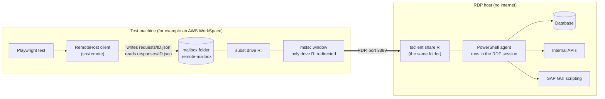
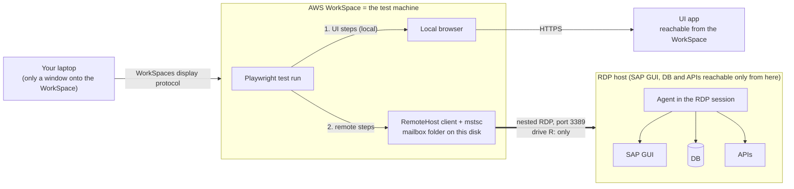

# Running steps on a remote desktop host

> **Status: NOT VERIFIED on a real Windows host.** This feature was written and tested on macOS. Everything that is TypeScript is covered by tests (against a stand-in agent). The Windows-specific parts - launching `mstsc`, `cmdkey`, `subst`, and the PowerShell agent (`agent/remote-agent.ps1`) - have **never been run** on Windows, against an RDP server, or even through a PowerShell parser. The [Verified / NOT verified](#verified--not-verified) section at the end lists exactly what is and is not proven. The first run on a real host is the verification: `automation-remote doctor`, then `automation-remote check`.

## What problem it solves

The tests run on a Windows **test machine** (for example an AWS WorkSpace). The application under test (the UI) is reachable from there. The database, the APIs and SAP GUI are **not**: they can only be reached from a **remote Windows desktop host** (the RDP host) that has no internet access, and the only way in is Remote Desktop (RDP, port 3389) - no SSH, no WinRM, no other port. SAP GUI runs in the interactive RDP session, and SAP GUI scripting only sees the interactive desktop, so whatever drives it has to run **inside** the logged-in RDP session.

This feature puts the RDP login in `.env`, and gives tests (and the `api` / `sap` packages, later) a client that performs DB, HTTP, SAP and other steps *on* that host, while the rest of the test (UI steps, assertions) stays on the test machine.

## How it works: the RDP drive mailbox

The test machine opens an RDP session to the host with **one** redirected drive: a `subst` drive letter that maps to a private mailbox folder (never a real drive such as `C:`). Inside the session that folder appears as `\\tsclient\<L>`. A small PowerShell **agent**, started inside the session, polls the folder for request files, runs them on the host (which can reach the DB / APIs / SAP) and writes response files. The client on the test machine writes requests and waits for responses. No port other than 3389 is needed and nothing is installed on the host: the agent script itself is delivered through the same redirected folder.



Folder layout under the mailbox (`REMOTE_SHARE_DIR`, default `.remote-mailbox/`); every file is written atomically (`<name>.tmp`, then rename):

| Path | Written by | Content |
|---|---|---|
| `requests/<id>.json` | client | `{v:1, id, type, payload, timeoutMs, createdAt, correlationId?}` |
| `responses/<id>.json` | agent | `{v:1, id, ok, result?, error?:{code,message,detail?}, durationMs}` |
| `agent/remote-agent.ps1`, `agent/start.cmd` | client (copied on connect, replaced when they differ) | the agent |
| `agent/config.json` | client | allow list, `pollMs`, `heartbeatMs` (the agent re-reads it when it changes) |
| `agent/heartbeat.json` | agent | `{agentVersion, pid, host, user, sessionId, interactive, psVersion, startedAt, updatedAt, allow}` every `REMOTE_HEARTBEAT_MS` |
| `agent/agent.log` | agent | what it did (request id, type, outcome - never bodies, SQL, headers or credentials) |
| `agent/clients/`, `agent/starting.lock` | client | which processes use the session; who is opening it |

The wire contract is `src/remote/protocol.ts` (request types `ping`, `http`, `db.query`, `db.update`, `exec`, `proc.start`, `proc.send`, `proc.stop`, `shutdown`; error codes `DENIED`, `BAD_REQUEST`, `TIMEOUT`, `REMOTE_ERROR`, `NOT_FOUND`). A test (`tests/remoteProtocol.spec.ts`) fails when the PowerShell agent and `protocol.ts` disagree on names, error codes, the capability table or the heartbeat fields.

The agent handles **one request at a time**, in order. Many requests can be in flight from the client (and from several worker processes); they queue, and each request's timeout includes the queueing time.

## Where each piece runs: three hops

One test usually mixes **local** steps (the UI, in a browser on the test machine) and **remote** steps (SAP, DB, internal APIs on the RDP host):



## Requirements on the test machine

- **The tests must be started from an interactive, logged-in desktop session** on the test machine. `mstsc` needs a desktop to show its window on: a Windows service, a scheduled task that runs without a desktop, or a Linux WorkSpace cannot launch it. (With `REMOTE_AGENT_START=startup` or `manual` you open the RDP window yourself, but the session that holds it still has to exist.)
- **Keep that session connected while the tests run.** If you disconnect from the WorkSpace, or it locks and drops, the `mstsc` window - and with it the RDP link, the drive and the agent - goes away; requests then fail with `AGENT_STALE`.
- Windows with `mstsc`, `cmdkey` and `subst` on the `PATH` (all standard). Node 18+.
- A spare drive letter (`REMOTE_DRIVE_LETTER`, default `R`).
- **The RDP link is nested**: it runs inside the WorkSpace's own session, from the WorkSpace to the RDP host. So the policies that matter are the **RDP host's** - drive redirection must be allowed there (GPO "Do not allow drive redirection" must not apply) and its `alternate shell` handling must work - not your laptop's. The redirected folder lives on the **WorkSpace's disk** (`REMOTE_SHARE_DIR`), not on your laptop. Whatever policy the WorkSpace itself has about running `mstsc` or `subst` applies as well.
- A login on the RDP host that may use Remote Desktop, and a session that stays unlocked and connected (SAP GUI scripting only sees an interactive desktop; a locked or disconnected session breaks it). Minimising the RDP window is fine; closing it is not.

`automation-remote doctor` reports whether the current process looks like it runs in an interactive Windows session (it checks `SESSIONNAME`) and **warns** - it does not fail - when it does not.

## One-time setup, per start mode

`REMOTE_AGENT_START` chooses how the agent gets started inside the RDP session.

### `alternate-shell` (default) - nothing to install

This machine does everything: `subst` maps the drive, `cmdkey` hands the login to `mstsc` while it connects, `mstsc` opens a session with only that drive redirected, and the session's `alternate shell` is `powershell.exe -NoProfile -ExecutionPolicy Bypass -WindowStyle Minimized -File \\tsclient\<L>\agent\remote-agent.ps1` - so the agent starts instead of Explorer. Set the keys below (`REMOTE_RDP_USER` and `REMOTE_RDP_PASSWORD` are required) and run `automation-remote check`. Not every server honours `alternate shell` (see Troubleshooting); then use one of the next two modes.

Because the agent *is* the session's shell, ending the agent (the shutdown request on `close()`) ends the session. SAP GUI is started by your steps from the agent's session, so there is no Explorer or taskbar on the host: that is expected.

### `startup` - the agent starts at logon

You open the RDP session yourself, and the agent starts from the host's Startup folder. One time:

1. `automation-remote agent-dir` (creates the mailbox with the agent files in it).
2. `subst R: "<REMOTE_SHARE_DIR>"` on the test machine.
3. Open `mstsc` to the host, **Show Options > Local Resources > Local devices and resources > More... > Drives**, tick **only R:**, connect, log in.
4. In the session: Win+R, `shell:startup`, Enter; create `remote-agent.cmd` there containing the one line `powershell.exe -NoProfile -ExecutionPolicy Bypass -WindowStyle Minimized -File \\tsclient\R\agent\remote-agent.ps1`.
5. Log off and connect again (steps 2-3), or run that line once. `automation-remote check` should now PASS.

`automation-remote setup-help` prints these steps with your real drive letter and folder. The Startup entry only works in a session opened with the drive redirected.

### `manual` - you start it each time

Steps 1-3 as above, then in the session run `\\tsclient\R\agent\start.cmd` (Win+R). `start.cmd` runs `remote-agent.ps1` from the folder it is in (`start.cmd R` runs it from `\\tsclient\R\agent`).

In `startup` and `manual` mode `connect()` prints what to do (a clear log line) and waits up to `REMOTE_CONNECT_TIMEOUT_MS` for the agent's heartbeat. `close()` leaves the agent running unless `REMOTE_LOGOFF=true`.

## Settings (`.env.<env>`; secrets only in `.env.<env>.local`)

Everything is read with the strict `ConfigReader` getters, so a typo is an error, not a silent default. Copy the keys from `.env.example`. **`REMOTE_RDP_PASSWORD` and `REMOTE_DB_CONNECTION_STRING` are secrets: put them in `.env.<env>.local` (git-ignored) or the CI secret store - never in a committed file.** `RemoteConfig` masks them in `JSON.stringify`, `util.inspect` and spreads; no error message or log line contains them.

| Key | Default | Meaning |
|---|---|---|
| `REMOTE_ENABLED` | `false` | Master switch. When not `true`, `getRemoteHost()` returns `undefined` and callers use their local services. |
| `REMOTE_RDP_HOST` | - (required when enabled) | Host name or address of the RDP host (no scheme). |
| `REMOTE_RDP_PORT` | `3389` | RDP port. |
| `REMOTE_RDP_USER` | - | Login. May be written `DOMAIN\user`. Required for `alternate-shell`. |
| `REMOTE_RDP_PASSWORD` | - | **Secret.** Required for `alternate-shell`. Handed to `mstsc` through `cmdkey` only while it connects. |
| `REMOTE_RDP_DOMAIN` | - | Optional domain (alternative to `DOMAIN\user`; a contradiction between the two is an error). |
| `REMOTE_SHARE_DIR` | `<cwd>/.remote-mailbox` | The mailbox folder on the test machine. Git-ignored. |
| `REMOTE_DRIVE_LETTER` | `R` | The `subst` drive redirected into the session. One letter; `A`, `B`, `C` are refused. A letter already mapped to a *different* folder, or a real drive, is refused. |
| `REMOTE_AGENT_START` | `alternate-shell` | `alternate-shell`, `startup` or `manual` (above). |
| `REMOTE_ALLOW` | `http,db,sap` | What the agent may be asked to do: `http`, `db`, `sap` (the line-protocol helper processes), `exec`. **`exec` runs arbitrary commands on the host and must be listed explicitly.** |
| `REMOTE_CONNECT_TIMEOUT_MS` | `180000` | How long `connect()` waits for the agent's heartbeat. |
| `REMOTE_REQUEST_TIMEOUT_MS` | `60000` | Default wait for one request's answer. |
| `REMOTE_POLL_MS` | `200` | How often the client (and the agent) look at the folder. |
| `REMOTE_HEARTBEAT_MS` | `2000` | How often the agent writes `heartbeat.json`. |
| `REMOTE_HEARTBEAT_STALE_MS` | `10000` | A heartbeat older than this (by the file's age on the test machine, so a wrong clock on the host does not matter) means the agent is gone. Must be at least twice `REMOTE_HEARTBEAT_MS`. |
| `REMOTE_RDP_WIDTH`, `REMOTE_RDP_HEIGHT` | `1280`, `800` | Size of the RDP desktop. |
| `REMOTE_RDP_KEEP_OPEN` | `false` | `false`: `close()` shuts the session down and closes our `mstsc`. `true`: leave everything running for the next run. |
| `REMOTE_LOGOFF` | `false` | `close()` also asks the host to log the Windows session off (for `startup` / `manual`, where the session would otherwise stay). |
| `REMOTE_DB_PROVIDER` | - | A .NET `DbProviderFactories` invariant name, e.g. `System.Data.SqlClient` or `System.Data.Odbc`. The provider must exist on the host. |
| `REMOTE_DB_CONNECTION_STRING` | - | **Secret.** The connection string *as the host uses it*. |

## Using it from tests

```ts
import { remote } from '@automation/referenced-automation-utils';

test('order shows up in the DB and the API', async () => {
  const host = await remote.getRemoteHost();           // undefined unless REMOTE_ENABLED=true
  if (!host) test.skip(true, 'remote host not enabled');

  // DB on the host. Parameters are positional: @p0, @p1 ... for SqlClient, ? for ODBC.
  const { rows } = await host!.dbQuery('SELECT TOP 1 status FROM orders WHERE id = @p0', [42]);

  // An HTTP call made FROM the host (redirects are not followed unless asked; the host's proxy is not used).
  const reply = await host!.http({ method: 'GET', url: 'https://internal-api.corp/orders/42', headers: { Authorization: `Bearer ${token}` } });
  expect(reply.status).toBe(200);
  expect(JSON.parse(remote.bodyText(reply)).status).toBe(rows[0].status);
});

test.afterAll(() => remote.closeRemoteHost());
```

- `getRemoteHost(env?)` connects once per worker process (lazily) and returns the same `RemoteHost` afterwards; `closeRemoteHost()` ends this process's use of it. When several worker processes share one session, the **last one out** closes it. A failed connect is remembered, so later tests fail at once instead of each waiting out the timeout.
- `new remote.RemoteDbClient(host)` (or `await remote.RemoteDbClient.fromEnv()`) is a `DbClient`: code written against `DbClient` does not change when the database is only reachable through the host.
- `host.exec({ command, args?, shell?, cwd?, timeoutMs?, env? })` needs `exec` in `REMOTE_ALLOW` and is refused on the client **and** by the agent otherwise.
- `host.startProcess({ scriptText | file, args? })` starts a helper process on the host that speaks a line protocol on stdin / stdout (`send(line, timeoutMs)` returns the next line, `stop()` ends it) - this is what hosts the SAP PowerShell bridge. It needs `sap` in `REMOTE_ALLOW`. A `send` that times out stops the process (a late answer would be taken for the next one).
- Errors are `RemoteError` with a `code`: `NOT_ENABLED`, `UNSUPPORTED_PLATFORM`, `RDP_LAUNCH_FAILED`, `AGENT_NOT_STARTED`, `AGENT_STALE`, `DENIED`, `TIMEOUT`, `REMOTE_ERROR`, `PROTOCOL` (`remoteCode` carries the agent's own code, e.g. `NOT_FOUND`).
- The test's correlation id is sent with every request and written to `agent.log`, so one value can be grepped on both sides.

**How the `api` and `sap` packages will use it:** the `api` package will route its HTTP client through `host.http` and its DB client through `RemoteDbClient` when `REMOTE_ENABLED=true`, and the `sap` package will run its PowerShell bridge through `host.startProcess` (the `proc.*` requests exist for exactly that). **Those integrations follow in the `api` and `sap` repos; this package only provides the remote host.**

### Command line

| Command | What it does |
|---|---|
| `automation-remote doctor` | Local prerequisites: valid configuration (secrets masked), Windows, `mstsc` / `cmdkey` / `subst`, interactive session (a warning only), bundled agent files, writable mailbox. |
| `automation-remote check [--url <http url>] [--db] [--exec]` | Connects, then PASS/FAIL per stage with a hint: mailbox, agent, ping, interactive desktop, optional HTTP GET from the host, optional `SELECT 1`, optional `hostname`. |
| `automation-remote open` | Connects and leaves the session open. |
| `automation-remote close` | Asks a running agent to shut down (and releases the `subst` drive). |
| `automation-remote agent-dir` | Prints `<REMOTE_SHARE_DIR>/agent` (created with the agent files). |
| `automation-remote setup-help` | The one-time steps for `startup` / `manual`. |

## Security and trade-offs

- **What crosses the drive:** SQL text and parameters, HTTP headers (including `Authorization` tokens) and bodies, DB connection strings, exec command lines and helper scripts - as JSON files in the mailbox. The client deletes each request and response as soon as it has the answer, and the agent drops requests older than 10 minutes and orphaned responses. Anyone who can read the mailbox folder on the test machine while a request is in flight can read them: keep `REMOTE_SHARE_DIR` in a folder only the test user can read.
- **Only the mailbox is shared.** The `subst` drive keeps the test machine's real drives out of the session; clipboard, printers, COM ports, smart cards and audio are switched off in the `.rdp` file.
- **The login:** the password is never in the `.rdp` file. `cmdkey` stores it as the generic credential `TERMSRV/<host>` so `mstsc` can use it; it is deleted again as soon as the agent's heartbeat appears **or** the connect times out (also when the launch fails). While `mstsc` connects, the password is on the `cmdkey` command line (visible to other processes of the same machine for that moment) - `cmdkey` offers no other way. It overwrites, then deletes, any credential you had saved for the same host. With the credential gone, `mstsc` can not re-authenticate if the network drops later in the session.
- **`exec` is off by default** (`REMOTE_ALLOW`), checked on both sides. `sap` is also powerful: `proc.start` runs a script text as PowerShell, so grant `sap` only to suites that drive SAP GUI.
- **The agent runs as the logged-in user** on the host, with that user's rights; it only reads and writes inside the mailbox (plus what the requests ask for). It never logs request bodies, SQL, headers or connection strings, and scrubs `password=...` / `Bearer ...` from the error texts it sends back.
- **Drive redirection can be disabled by group policy** on the host (a common hardening step). Then this transport can not work at all - there is no other channel by design.
- **Authentication level 2** in the `.rdp` file: if the host's certificate is not trusted, `mstsc` may show a warning dialog that blocks an unattended run. Accept it once ("don't ask again") or install the host's CA on the test machine.
- **The session must stay up**: the minimised RDP window has to stay open, and the session must not be locked, disconnected or logged off while tests run, or SAP GUI scripting (which needs an interactive desktop) stops working. When the session goes, requests fail with `AGENT_STALE` rather than hanging.
- **One request at a time** on the host: slow requests delay the ones behind them. Run suites that use the remote host with few workers.
- The mailbox is a polling channel (default every 200 ms each way): expect roughly 0.2-0.5 s of latency per request on top of the work itself.
- Parallel worker processes share one session; the first one opens it (a lock file keeps two from opening two sessions) and the last one out closes it. With `REMOTE_RDP_KEEP_OPEN=true` nobody closes it. A leftover `subst` mapping after parallel workers is harmless (`subst R: /D` removes it).

## Troubleshooting

| Symptom | Likely cause | What to do |
|---|---|---|
| `AGENT_NOT_STARTED` after the connect timeout | The error message lists the causes; the common ones are the next rows. | Read the message, then `agent/agent.log` in the mailbox folder. |
| `mstsc` shows a login failure, or its window closes at once | Wrong user / password / domain; the account may not log on through Remote Desktop; port 3389 not reachable from the test machine. | Log in once by hand with the same values; check `REMOTE_RDP_USER` / `REMOTE_RDP_DOMAIN`; `Test-NetConnection <host> -Port 3389` in PowerShell on the test machine. |
| Session opens, nothing happens, `\\tsclient\R` does not exist | Drive redirection is blocked on the RDP host (GPO "Do not allow drive redirection"). | Ask the host's administrators; there is no workaround inside this design. |
| Session opens with a normal desktop, no agent | The server ignored `alternate shell`. | Use `REMOTE_AGENT_START=startup` or `manual`. |
| Agent window flashes and disappears; `agent.log` missing or ends in an error | PowerShell blocked (execution policy by GPO, AppLocker, constrained language mode), or the script failed. | Run `\\tsclient\R\agent\start.cmd` by hand in the session and read the error; report it - the agent has never run on Windows yet. |
| `UNSUPPORTED_PLATFORM` | `alternate-shell` on a machine that is not Windows, or `mstsc` / `cmdkey` / `subst` missing from the `PATH`. | Run on the Windows test machine, or use `startup` / `manual`. |
| `RDP_LAUNCH_FAILED`: drive already mapped | The drive letter points at another folder or is a real drive. | Pick another `REMOTE_DRIVE_LETTER`, or `subst R: /D` if it is a leftover. |
| `AGENT_STALE` | The RDP window was closed, the WorkSpace session disconnected or locked out, the host logged the session off (idle limit), or the agent crashed. | Keep the session connected; check the host's session time limits; see `agent.log`. |
| `TIMEOUT` | The agent is alive but busy with an earlier request, or the operation is slow. | Raise the request's timeout; avoid long operations in parallel. |
| `DENIED` | The operation is not in `REMOTE_ALLOW`. | Add it (`exec` only deliberately). |
| `DB provider "..." is not installed on this host` | `REMOTE_DB_PROVIDER` names a .NET provider the host does not have. | Use one the host has (`System.Data.SqlClient` is part of .NET Framework; ODBC needs a DSN or driver). |
| Certificate warning dialog in `mstsc` | `authentication level:i:2` and an untrusted host certificate. | Accept once with "don't ask again". |
| SAP GUI steps fail although the agent answers | The agent is not on an interactive desktop (`automation-remote check` flags it) or the session is locked. | Start the agent inside the logged-in session; keep it unlocked. |

## Verified / NOT verified

**Verified (tests, on macOS, against a TypeScript stand-in agent that speaks the same protocol over the same folder layout):**

- Configuration parsing and validation, secret masking, `DOMAIN\user` handling, drive-letter and allow-list rules.
- The client: ping, HTTP (headers, body, redirects off by default, timeouts), DB (query, update, parameters, row cap), `exec` denied by default and allowed when listed, the agent-side `DENIED`, `TIMEOUT` and `AGENT_STALE` behaviour, the `AGENT_NOT_STARTED` checklist, parallel requests, the line-protocol processes, shutdown, reuse of a running agent, the last-client-out rule, one RDP session for parallel workers, leftover-file cleanup, atomic file writes (a second process polling never sees a partial file).
- `rdp.ts` against a **recording fake command runner**: the exact `subst` / `cmdkey` / `mstsc` invocations and their order, the `.rdp` text (only the subst drive redirected, no password), `cmdkey /delete` in every failure path, the platform refusal, the drive-conflict refusal.
- The contract between `protocol.ts` and `agent/remote-agent.ps1`: names of request types, handlers, error codes, capability table, heartbeat fields, versions and limits (text comparison only); that both agent files are ASCII with no tabs, carry the banner, and that brackets balance.
- The `automation-remote` CLI against the stand-in agent.

**NOT verified (nothing below has run on a real Windows host or RDP server):**

- `agent/remote-agent.ps1`: it has never been executed or parsed by PowerShell. Syntax, the .NET calls (`HttpClient`, `DbProviderFactories`, `Process`), `JavaScriptSerializer` behaviour, the heartbeat runspace, the named mutex and PowerShell 5.1 specifics are all unproven.
- `mstsc` behaviour: that it honours `drivestoredirect` for a `subst` drive, `alternate shell`, `shell working directory`, `domain:s:` next to `username:s:`, `prompt for credentials:i:0` with a `cmdkey` credential, and `authentication level:i:2` as assumed.
- `cmdkey` / `subst` output formats (`subst` listing parsed as `R:\: => <path>`; English output assumed) and exit codes, elevation / UAC effects on `subst` visibility.
- That the RDP host exposes `\\tsclient\<L>` to the agent early enough at logon, that file modification times written through the redirected drive are stamped by the test machine's clock (the heartbeat staleness rule relies on it), and that `File.Replace` / `File.Move` over `\\tsclient` behave atomically.
- Behaviour on an AWS WorkSpace (nested RDP, its own policies) and on the real host's group policies.
- That SAP GUI scripting works from a process started by the agent (it needs an interactive, unlocked desktop).

## Related

- `src/remote/` - the client; `agent/` - the agent; `src/cli/remote.ts` - `automation-remote`.
- [ADR 0012](adr/0012-remote-host-over-rdp-drive-mailbox.md) - why this design and what else was considered.
